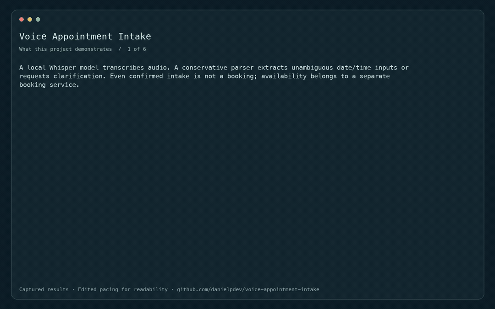
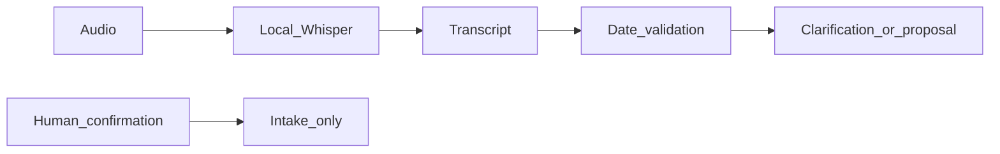

# Voice Appointment Intake

Local transcription and date clarification before booking.

[](https://github.com/danielpdev/voice-appointment-intake/actions/workflows/ci.yml)

**Role focus:** Voice AI / Applied Python. **Status:** working local portfolio implementation, with synthetic data.

## Demo



Edited replay of captured CLI outputs in deterministic fixture mode. This is not live model inference. [Full recording](docs/demo.mp4). Rebuild with `./scripts/render_gif.sh` (FFmpeg required).

## The engineering decision

A local Whisper model transcribes audio. A conservative parser extracts unambiguous date/time inputs or requests clarification. Even confirmed intake is not a booking; availability belongs to a separate booking service.



## Run locally

Requirements: Python 3.12, [uv](https://docs.astral.sh/uv/getting-started/installation/) and Make.

```bash
git clone https://github.com/danielpdev/voice-appointment-intake.git
cd voice-appointment-intake
make setup
make demo
make test
make eval
```

`make demo` uses an isolated temporary database where relevant, so it is safe to repeat. `make eval` writes a timestamped report to `reports/evaluation-fixture.json`. Fixture mode is deterministic and does not represent model inference. There is no recurring hosting or API subscription cost.

`make serve` opens the local API on `http://127.0.0.1:8119/docs`.

`make eval-local` installs the audio extra and transcribes `data/sample.wav` with local Whisper tiny.en. Initial model download requires internet. The sample is synthetic macOS speech, created for this repository.

[Watch the recorded demo](docs/demo.mp4) · [Reproduce the walkthrough](docs/DEMO.md)

## Verification and evidence

Invalid dates/times, ambiguous multiple dates, missing confirmation and the distinction between confirmed intake and a booked appointment. A synthetic spoken sample was transcribed locally.

- [Evaluation report](reports/evaluation-fixture.json) — measured during an actual run; inspect the mode and dataset size.
- [Development and authorship](docs/DEVELOPMENT.md).
- [Romanian interview preparation](docs/INTERVIEW_RO.md).
- [Design notes](docs/DESIGN.md).
- [Demo walkthrough](docs/DEMO.md).

CI uses standard GitHub-hosted runners and deterministic tests without downloading LLM weights. The lockfiles record exact package versions. Local-model results, when present, live in `reports/evaluation-local.json`; hardware/model identities are in `reports/environment.json`.

## Limits and next iteration

The bundled audio is synthetic macOS speech, not a human recording. English-only tiny.en and a conservative date parser are small baselines. No telephony integration, diarization or voice cloning is included.

Next: Add time-zone selection and a larger consented ASR/date-extraction evaluation set.

The local demonstration does not include production authentication, secret management or operational service guarantees. Bind it to localhost and use synthetic data. These projects demonstrate engineering decisions; they do not claim real customers, paid production deployments or guaranteed interviews.

## Project ownership

Implemented with Codex assistance for Daniel Popa. The owner should review the code, run it, make an independent change and rehearse the tradeoffs before presenting it at interview. That human understanding check is pending and cannot be verified automatically. See [development notes](docs/DEVELOPMENT.md).

MIT for original source; dependencies/models retain their own licenses. See [third-party notices](THIRD_PARTY.md).

Use `make serve-local` to start the API/UI with its optional local-model dependencies explicitly enabled.
